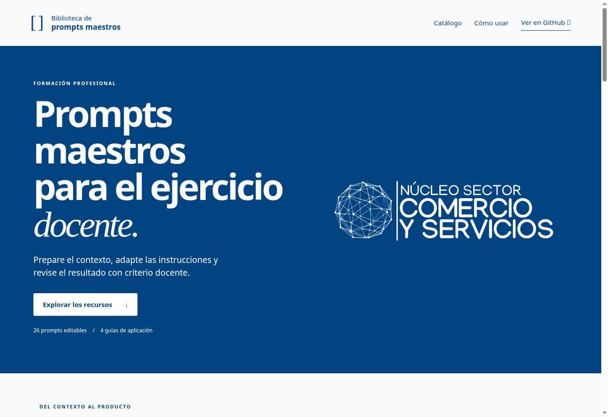

# Biblioteca de prompts maestros

**Prompts maestros para el ejercicio docente**  
26 prompts maestros editables y 4 guías de aplicación para personal docente de formación profesional.

Cada recurso incluye campos entre corchetes, decisiones ante información faltante, procedimiento específico, formato de entrega, criterios de aceptación y un ejemplo de adaptación.

## Explorar la biblioteca

La [biblioteca en línea](https://astrid347.github.io/Biblioteca-de-prompts-maestros/) permite buscar por producto, filtrar por área, completar campos y copiar o descargar el prompt. Para usarla en su computadora, [descargue el repositorio](https://github.com/Astrid347/Biblioteca-de-prompts-maestros/archive/refs/heads/main.zip), descomprímalo y abra `index.html`.

También puede consultar todos los recursos desde el catálogo siguiente.

## Cómo trabajar con un prompt maestro

1. Elija el producto según su propósito.
2. Prepare las fuentes y los datos de la población.
3. Reemplace los campos entre corchetes. Marque «Por confirmar» o «No aplica» cuando corresponda.
4. Copie el prompt en su herramienta de IA y adjunte las fuentes pertinentes.
5. Contraste el resultado con los referentes y aplique su criterio docente antes de utilizarlo.

Los campos de la interfaz se procesan en el navegador. La generación del producto se realiza en la herramienta de IA que usted elija. Comparta datos anonimizados cuando corresponda.

## Catálogo completo

### Diseño y planificación curricular

- [01 · Diagnóstico de necesidades de formación](prompts/01-diagnostico-necesidades-formacion.md)
- [02 · Diseño de un programa o curso](prompts/02-diseno-de-un-programa-o-curso.md)
- [03 · Diseño de una unidad de aprendizaje](prompts/03-diseno-de-una-unidad-de-aprendizaje.md)
- [04 · Formulación de competencias y resultados de aprendizaje](prompts/04-formulacion-de-competencias-y-resultados-de-aprendizaje.md)
- [05 · Matriz de alineación curricular](prompts/05-matriz-de-alineacion-curricular.md)
- [06 · Planeamiento de una sesión formativa](prompts/06-planeamiento-de-una-sesion-formativa.md)

### Actividades y experiencias de aprendizaje

- [07 · Actividad de aprendizaje guiada](prompts/07-actividad-de-aprendizaje-guiada.md)
- [08 · Caso de estudio para analizar y decidir](prompts/08-caso-de-estudio-para-analizar-y-decidir.md)
- [09 · Simulación o juego de roles](prompts/09-simulacion-o-juego-de-roles.md)
- [10 · Proyecto integrador aplicado](prompts/10-proyecto-integrador-aplicado.md)
- [11 · Secuencia de autoaprendizaje](prompts/11-secuencia-de-autoaprendizaje.md)

### Recursos didácticos y comunicación visual

- [12 · Presentación de alto impacto](prompts/12-presentacion-de-alto-impacto.md)
- [13 · Presentación corta de microaprendizaje](prompts/13-presentacion-corta-de-microaprendizaje.md)
- [14 · Mapa mental](prompts/14-mapa-mental.md)
- [15 · Mapa conceptual](prompts/15-mapa-conceptual.md)
- [16 · Infografía didáctica](prompts/16-infografia-didactica.md)
- [17 · Guía de estudio para la persona participante](prompts/17-guia-de-estudio-para-la-persona-participante.md)
- [18 · Guion didáctico para producción multimedia](prompts/18-guion-didactico-para-produccion-multimedia.md)

### Evaluación y retroalimentación

- [19 · Evaluación diagnóstica de entrada](prompts/19-evaluacion-diagnostica-de-entrada.md)
- [20 · Actividad de comprobación del aprendizaje](prompts/20-actividad-de-comprobacion-del-aprendizaje.md)
- [21 · Prueba práctica de desempeño](prompts/21-prueba-practica-de-desempeno.md)
- [22 · Banco de ítems con tabla de especificaciones](prompts/22-banco-de-items-con-tabla-de-especificaciones.md)
- [23 · Rúbrica analítica](prompts/23-rubrica-analitica.md)
- [24 · Lista de cotejo para procedimientos o productos](prompts/24-lista-de-cotejo-para-procedimientos-o-productos.md)
- [25 · Retroalimentación formativa basada en evidencias](prompts/25-retroalimentacion-formativa-basada-en-evidencias.md)

### Acompañamiento con IA en el aula

- [26 · Diseño de un asistente pedagógico con fuentes del módulo](prompts/26-diseno-de-un-asistente-pedagogico-con-fuentes-del-modulo.md)

### Guías transversales

- [27 · Cómo aportar buenos datos para dar contexto a la IA](guias/27-como-aportar-buenos-datos-para-dar-contexto-a-la-ia.md)
- [28 · Cómo aplicar el criterio docente al revisar productos generados con IA](guias/28-como-aplicar-el-criterio-docente-al-revisar-productos-generados-con-ia.md)
- [29 · Cómo editar y ejecutar un prompt maestro](guias/29-como-editar-y-ejecutar-un-prompt-maestro.md)
- [30 · Cómo probar mejorar y versionar un prompt maestro](guias/30-como-probar-mejorar-y-versionar-un-prompt-maestro.md)

## Alcance y revisión

Versión 1.0. Los recursos constituyen una base editable para adaptar a la población, los referentes y el sistema de evaluación de cada institución. Los ejemplos son ilustrativos. La validación de exactitud técnica, tiempos, instrumentos y pertinencia corresponde al equipo docente que los aplique.

Para actualizar un recurso, registre qué cambió y compruebe los casos afectados. La guía 30 incluye un procedimiento de prueba y versionado.
